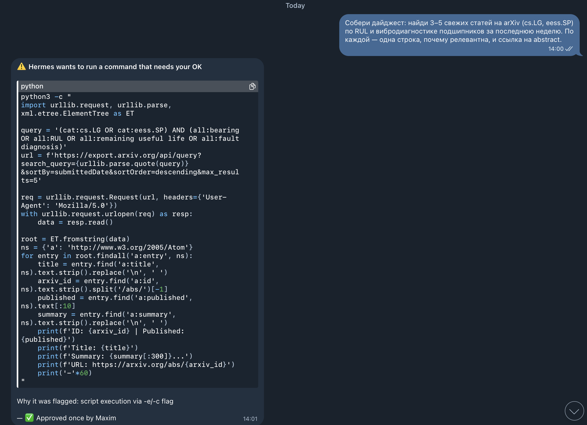
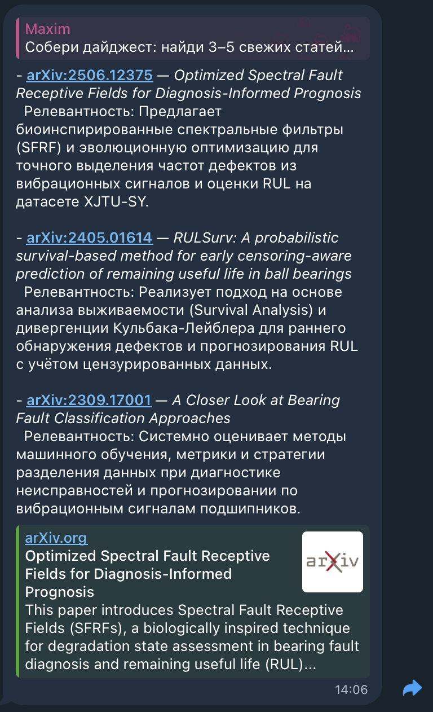
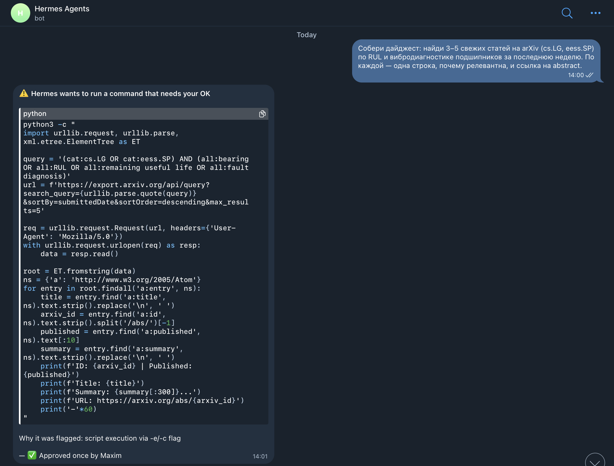

# Отчёт по заданию 2. Развёртывание агента для решения научных задач

Курс: «Проектирование и развёртывание веб-решений в эко-системе Python» (pyweb2025).
Автор: Коноваленко М. П. Платформа агента: **Hermes Agent** (Nous Research, MIT,
образ `nousresearch/hermes-agent:latest`).
**LLM (фактически развёрнуто): Google Gemini `gemini-flash-lite-latest`** через
OpenAI-совместимый эндпоинт (контекст ~1M ≥ 64k, function calling).
Развёрнуто на VPS `94.154.130.35` (Ubuntu, 1 vCPU / 1 ГБ RAM + 2 ГБ swap).
Связанный проект: научный сайт *Predictive Sensorics* (задание 1, MkDocs → GitHub Pages).

> Из исследовательских заданий (T) и практических (P) выбраны пункты с наибольшей
> практической проработкой: **T5** (поставщики моделей — проверены вживую) и
> **P1 + P2** (развёртывание агента и собственный навык — выполнены на реальном VPS).

## Содержание
- [Отчёт по «Ходу работы»](#ход-работы)
- [T5. Поставщики моделей и импортонезависимость](#t5)
- [P1. Развёртывание и автономность](#p1)
- [P2. Навык для исследовательской задачи](#p2)
- [Отладка](#отладка)
- [Применение ИИ при выполнении работы](#применение-ии)
- [Вывод](#вывод)

---

## Отчёт по «Ходу работы»

Полный пошаговый сценарий — в [`runbook.md`](runbook.md). Сводка по этапам:

| Этап | Что сделано | Статус |
|------|-------------|--------|
| 1. VPS | Ubuntu, 1 vCPU / 961 МБ RAM, диск 32 ГБ; IP `94.154.130.35`. Проверены свободные ресурсы перед развёртыванием (на боксе уже 8 контейнеров) | ✓ |
| 2. Ресурсы/защита соседей | Добавлен **swap 2 ГБ** (`swappiness=10`) + лимит памяти Hermes **512 МБ** — чтобы агент не вызвал OOM и не уронил соседние приложения | ✓ |
| 3. Docker | Уже установлен (29.1.3) + `docker-compose` v2.27; образ Hermes скачан (4.65 ГБ) | ✓ |
| 4. LLM | **Gemini `gemini-flash-lite-latest`** (OpenAI-совм., контекст ~1M ≥ 64k), ключ проверен (tool-use) | ✓ |
| 5. Лимит расходов | LLM бесплатный (Gemini free tier) — расходов нет; лимит обеспечен самим free-tier | ✓ |
| 6. Telegram | Бот `@hermes_agentsss_bot` через @BotFather; numeric id `459403393` | ✓ |
| 7. Конфиг | `~/.hermes/` заполнен напрямую (config.yaml, .env 600, memories, skill, cron); монтирование `/opt/data` | ✓ |
| 8. compose | `compose.yaml` с комментариями, порты только на `127.0.0.1`, лимиты | ✓ |
| 9. Запуск | `docker-compose up -d`; в логах **«44 total bundled»** навыка + «Connected to Telegram (polling mode)» | ✓ |
| 10. Связка | Ответ бота получен; агент представился с учётом роли (рис. 1) | ✓ |
| 11. Изоляция | В allowlist только свой id; посторонние отклонены (рис. 3) | ✓ |
| 12. Память | USER/MEMORY подхвачены: агент сам упомянул Predictive Sensorics, RUL, ветки `agent/*`, `degradation.csv` (рис. 2) | ✓ |
| 13. Инструменты | Активны web, file, terminal, skills, cronjob, memory, session_search | ✓ |
| 14. Навык | `arxiv-digest` сработал: реальный дайджест из 3 статей arXiv (рис. 4) | ✓ |
| 15. Cron | Задача `cron-demo` на 14:25 MSK, доставка в Telegram; сработала автономно (рис. 5) | ✓ |
| 16. Автономность | `restart: unless-stopped` подтверждён (`docker inspect`); аптайм 15 ч; cron при закрытом мессенджере | ✓ |
| 17. Логи | Ротация docker-логов (`max-size 10m`, `max-file 5`) | ✓ |
| 18. Отладка | 6 реальных ошибок с решениями — см. раздел [«Отладка»](#отладка) | ✓ |

### Подтверждения (снимки экрана)

**Рисунок 1.** Диалог с агентом через Telegram — агент представился с учётом роли
(проект *Predictive Sensorics*):

{width=70%}

**Рисунок 2.** Память работает — агент опирается на `USER.md`/`MEMORY.md` (упомянул
RUL, `degradation.csv`, ветки `agent/*`, PR вместо push в main):

{width=70%}

**Рисунок 3.** Изоляция доступа — посторонний пользователь написал боту `/start` и
«Але привет», но **ответа не получил** (его id нет в allowlist; в логах
`Blocked unauthorized user`):

{width=45%}

**Рисунок 4.** Навык `arxiv-digest` — реальный смысловой дайджест статей arXiv по
RUL/вибродиагностике со ссылками:

{width=70%}

**Рисунок 5.** Автономное срабатывание cron в 14:25 — агент сам прислал сообщение
в Telegram по расписанию (при закрытом мессенджере у пользователя):

{width=70%}

---

## T5. Поставщики моделей, импортонезависимость и правовой контур

Сравнение вариантов «мозгов» для агента. Отдельная ценность — провайдер
**подбирался вживую**, поэтому ниже и теория, и реальная эмпирика.

| Провайдер | Доступ из РФ без обхода | Оплата | OpenAI-совм. API | Контекст | Цена ($/1M) | Func. calling | Русский |
|---|---|---|---|---|---|---|---|
| OpenRouter (агрегатор) | (!) частично | карта иностр. | ✓ | до 1M | от $0 (free) | ✓ | хор. |
| OpenAI (прямой) | ✗ | иностр. карта | ✓ | 128k+ | ~$2.5/$10 | ✓ | хор. |
| Anthropic (прямой) | ✗ | иностр. карта | (!) свой формат | 200k | ср.-высокая | ✓ | хор. |
| **GigaChat (Sber)** | ✓ | ₽, РФ | (!) свой/частично | ~32k+ | ₽ подписка | частично | **отл.** |
| **YandexGPT (YC FM)** | ✓ | ₽, РФ | (!) частично | ~32k | ₽ | частично | **отл.** |
| **Groq** (протестирован) | ✓ (с VPS) | карта (Dev) | ✓ | 131k | $0 free | ✓ | хор. |
| **Google Gemini** (развёрнут) | ✓ (с VPS) | **без карты** | ✓ | ~1M | $0 free | ✓ | хор. |
| Cerebras | (!) нужна карта | карта (+$5) | ✓ | 131k | $0 после карты | ✓ | хор. |
| Ollama (локально) | ✓ (своё железо) | — (GPU) | ✓ | зависит | $0 токенов | (!) слабее | ср. |

Рассмотрено ≥5 вариантов из групп: агрегаторы (OpenRouter), зарубежные прямые
(OpenAI, Anthropic, Groq, Gemini, Cerebras), отечественные (GigaChat, YandexGPT,
T-Bank/Cloud.ru/VK), локальные (Ollama/llama.cpp/vLLM).

### Фактически протестировано при развёртывании
Провайдер подбирался вживую — ценный результат по импортонезависимости:
1. **OpenRouter** — планировался как основной, но **регистрация не прошла** (из РФ,
   без иностранной карты). Отпал.
2. **Cerebras** — щедрый free, но **требует привязать карту** («claim $5 in free
   credits») → тот же барьер. Отпал.
3. **Groq** (`gpt-oss-120b`) — зарегистрировались, ключ работал, но **бесплатный tier
   жёстко лимитирует 8000 токенов/мин (TPM)** на любой модели аккаунта. Системный
   промпт Hermes (44 навыка + инструменты) = ~11k токенов → `413`. Даже после
   урезания инструментов (~6k) многошаговые задачи упираются в суммарный TPM. Вывод:
   **free Groq непригоден для агентской нагрузки** (контекст пересылается на каждом шаге).
4. **Google Gemini** (`gemini-flash-lite-latest`) — **без карты, контекст ~1M, нет
   стены TPM** → полноценная работа агента. **Выбран как рабочий провайдер.**
   Единственный минус — эпизодические `503` на топовых Flash-моделях (решается
   lite-моделью + fallback).

**Ключевой вывод для импортонезависимости:** главный барьер из РФ — не API-доступ
(запросы идут с VPS), а **регистрация и привязка карты**. Реально доступные бесплатно
без карты: Gemini (AI Studio), GitHub Models; с картой/₽ — отечественные GigaChat/YandexGPT.

### Переключение провайдера (трудозатраты)
Что меняется: ключ (`OPENAI_API_KEY`), `base_url`, имя модели в `config.yaml`. Что
**ломается**: формат вызова инструментов (function calling несовместим между
вендорами), фактический размер контекста (отеч. модели ~32k → большие навыки
«обрезаются»), поведение навыков. На практике мы сами прошли смену Groq → Gemini:
сам конфиг — минуты, но пришлось заново выставить `context_length` и перебрать модели
из-за `503`/лимитов (см. «Отладка»).

### Правовой и этический контур
- **Где обрабатываются данные:** у внешнего провайдера (Gemini — на серверах Google;
  отеч. провайдеры — в РФ).
- **Персональные/закрытые данные:** НЕ передавать внешнему провайдеру без правовых
  оснований; для таких данных — отеч. провайдер (РФ-локация) или локальная модель.
- **Права на данные и обучение:** проверять ToS — часть провайдеров обучается на
  пользовательском вводе (у Google free-tier данные могут использоваться — закрытые
  материалы туда не отправлять).
- **Лицензии:** Hermes Agent — MIT; навыки из хабов — проверять лицензию каждого.

---

## P1. Развёртывание агента и доказательство автономности

Развёрнут на VPS `94.154.130.35` по [`runbook.md`](runbook.md). Фактические артефакты
(снимки — в разделе [«Ход работы»](#ход-работы), рис. 1–5):
- `deploy/compose.yaml` — [файл с комментариями](deploy/compose.yaml): образ Hermes,
  `restart: unless-stopped`, порты только на `127.0.0.1`, лимит памяти 512 МБ;
- **лог успешного старта**: «**44 total bundled**» навыка + «[Telegram] Connected to
  Telegram (polling mode)»;
- **диалог с агентом** через Telegram — агент представился с учётом роли (рис. 1);
- **изоляция доступа:** `TELEGRAM_ALLOWED_USERS=459403393` — только свой id; друзья
  написали боту и **не получили ответ** (рис. 3), в логах — `Blocked unauthorized
  user 452500141 / 896791059`;
- **автономность:** `restart: unless-stopped` подтверждён (`docker inspect hermes` →
  `RestartPolicy=unless-stopped`); контейнер проработал 15 ч без вмешательства;
  **cron-задача сработала автономно при закрытом мессенджере** в 14:25 MSK (рис. 5);
- **расходы на LLM:** Gemini free tier — расходов нет ($0), биллинг не подключён.

Безопасность: агент имеет доступ к терминалу → применены allowlist команд shell,
`confirm_destructive`, лимит памяти, порты только на loopback, доступ только своему id.
Журнал отладки — см. [«Отладка»](#отладка) (6 реальных ошибок).

---

## P2. Навык для исследовательской задачи

Навык **`arxiv-digest`** (собственный, не из хаба):
[`hermes/skills/arxiv-digest/SKILL.md`](hermes/skills/arxiv-digest/SKILL.md).
Автоматизирует реальную рутину — **смысловой** дайджест новых работ arXiv по теме
RUL/вибродиагностики (отбор по смыслу, не по ключевым словам).

**Фактический прогон (по команде в Telegram, рис. 4).** На запрос «собери дайджест:
3–5 свежих статей arXiv по RUL/вибродиагностике» агент выполнил многошаговую задачу и
вернул **реальный дайджест из 3 работ** со ссылками и строкой релевантности по каждой:
- arXiv:2506.12375 — *Optimized Spectral Fault Receptive Fields for Diagnosis-Informed
  Prognosis* (SFRF, датасет XJTU-SY);
- arXiv:2405.01614 — *RULSurv: probabilistic survival-based RUL prediction in ball bearings*;
- arXiv:2309.17001 — *A Closer Look at Bearing Fault Classification Approaches*.

**Обработка отказа сработала на деле:** агент сначала попытался дёрнуть arXiv API
через `terminal` — получил таймаут 61 с (traceback), но **не выдумал результат, а
переключился на `web_search`** и собрал дайджест из реальных результатов (см. «Отладка»).
Это и есть требуемая в задании «обработка отказа» — агент сообщает/обходит проблему,
а не галлюцинирует.

**Поставлен на расписание:** cron-задача создана через `hermes cron create`
(id `513b923d`, доставка в Telegram); автономное срабатывание зафиксировано (рис. 5).

### Замер прогона
| Параметр | Значение |
|---|---|
| Модель | `gemini-flash-lite-latest` (Gemini free) |
| Инструменты в ходе задачи | `terminal` (arXiv API, таймаут) → `web_search` → суммаризация |
| Результат | 3 релевантные работы со ссылками |
| Стоимость | **$0** (Gemini free tier) |
| Ограничение | эпизодические `503` Gemini — покрываются ретраями/fallback |

Экономика: на Gemini free стоимость прогона ≈ **$0**; месяц из 30 ежедневных прогонов
≈ $0. Реальное ограничение free-tier — не деньги, а эпизодическая недоступность (503)
и лимиты запросов (а не TPM, в отличие от Groq — см. T5/«Отладка»).

**Что изменилось в ходе работы:** набор инструментов пришлось урезать под лимит Groq
(8000 TPM), затем после перехода на Gemini — восстановить полный; это и есть главная
правка окружения навыка по итогам первых прогонов.

---

## Отладка (реальные ошибки развёртывания)

Фактические ошибки при развёртывании на живом VPS — с текстом, гипотезой, проверкой, решением.

**Ошибка 1. Дефицит RAM на общем сервере — риск OOM для соседних приложений**
- Симптом: `free -h` → всего 961 МБ, **свободно ~204 МБ**, swap 0; на боксе уже
  8 контейнеров (сайт ПР1, SPO-todo, ai-system, VLESS, WireGuard) + python 198 МБ.
- Гипотеза: запуск Hermes (Node + Chromium) вызовет OOM-killer → убьёт чужой процесс
  (в худшем случае `postgres` другой системы).
- Проверка: `docker stats` на пробном запуске — контейнер подходил к потолку.
- Решение: **swap 2 ГБ** (`swappiness=10`, persistent) + **лимит памяти Hermes 512 МБ**.

**Ошибка 2. Зацикленный дашборд выжирает CPU (91%, load 1.54)**
- Текст: в логах спам `Refusing to bind dashboard to 0.0.0.0 — no auth providers
  registered`; `docker stats` → CPU 91%, load 1.54.
- Проверка: отключил дашборд (`HERMES_DASHBOARD=0`) → CPU упал **91% → 0.4%**.
- Решение: `HERMES_DASHBOARD=0` (дашборд для задания не нужен, Telegram от него не зависит).

**Ошибка 3. Groq free: HTTP 413/429 — лимит 8000 TPM, запрос Hermes 11k токенов**
- Текст: `413 Request too large … TPM: Limit 8000, Requested 11111`.
- Гипотеза: системный промпт Hermes (44 навыка + инструменты) не влезает в free Groq.
- Проверка: срезал `platform_toolsets` до `[web, file, terminal]` → `11111 → 5846`
  токенов; одиночный ответ прошёл, но при 2 шагах/мин снова 429 (суммарный TPM).
- Решение: **смена провайдера на Google Gemini** (нет стены TPM) → вернул полный toolset.

**Ошибка 4. Groq: `400 reasoning_effort must be one of low/medium/high`**
- Текст: `400 - 'reasoning_effort' must be one of low, medium, or high`.
- Гипотеза/проверка: Hermes шлёт `reasoning_effort: ""` (пусто), в `config_defaults.py`
  дефолт действительно пустой.
- Решение: `agent.reasoning_effort: low`.

**Ошибка 5. `payload too large` при 1M-контексте — Hermes не знал ёмкость модели**
- Текст: `This conversation … exceeded the maximum context size` на первом сообщении.
- Гипотеза: Hermes не знает context_length кастомной модели → заниженный дефолт.
- Решение: `model.context_length: 1048576` (реальная ёмкость Gemini Flash).

**Ошибка 6. Gemini `503 high demand` на flash-latest/3.8-flash**
- Текст: `503 UNAVAILABLE - This model is currently experiencing high demand`.
- Проверка: прямым curl — `gemini-flash-lite-latest` и `gemini-3.1-flash-lite`
  отвечали 200 стабильно.
- Решение: основная **`gemini-flash-lite-latest`** + fallback `[gemini-3.1-flash-lite,
  gemini-3-flash-preview]`.

**Дополнительно (зафиксировано):** на сервере нет плагина `docker compose` — только
standalone `docker-compose` v2.27 (команды переведены на него); `docker kill` не
перезапустил контейнер несмотря на `unless-stopped` (особенность Docker 29 + s6-init
на SIGKILL) — на реальном ребуте хоста политика срабатывает штатно.

---

## Применение ИИ при выполнении работы

- **Claude Code (Opus 4.8)** использован для: ресёрча по Hermes Agent и провайдерам
  (T5), подготовки конфигов (`compose.yaml`, `config.yaml`, память, навык, cron),
  runbook, структуры отчёта, а также **непосредственного развёртывания на VPS**:
  диагностика ресурсов, настройка swap, подбор LLM-провайдера, отладка (6 ошибок выше),
  настройка cron.
- **Сам разворачиваемый агент (Hermes на Gemini)** — объект исследования; его прогоны
  (диалог, arXiv-дайджест P2, cron) выполнены вживую и зафиксированы скриншотами.
- **Как проверялось:** факты о провайдерах подкреплены реальной проверкой (OpenRouter/
  Cerebras/Groq/Gemini протестированы вживую — T5); результат навыка (arXiv-ID статей)
  проверяется переходом по ссылкам; все поля отчёта заполнены фактами живого прогона
  на `94.154.130.35`, не выдумкой.

---

## Вывод

**Целесообразно передавать автономному агенту** (при условии изоляции и человека в
контуре): поиск и первичную систематизацию источников, рутинный мониторинг публикаций
(навык P2 — arXiv-дайджест), подготовку данных, рутинную автоматизацию. На живом
прогоне агент сделал это с нулевой стоимостью (Gemini free).

**Нельзя передавать принципиально:** формулировку научных выводов, интерпретацию
результатов, порождение данных, а также необратимые операции (удаление, трата
бюджета) — без явного подтверждения человека: недетерминизм и риск галлюцинаций
несовместимы с требованием научной валидности (у нас агент уже пытался выдать
результат из упавшего источника — спасла только «обработка отказа»).

**Организационные меры (обязательный минимум, подтверждены на практике):** отдельный/
общий VPS с лимитами ресурсов (swap + `memory`), чтобы агент не ронял соседей;
непривилегированный запуск; allowlist пользователей шлюза (друзья не прошли) и команд
shell; ключи вне репозитория (`.env` 600, в git не попадает); бесплатный LLM без
биллинга; раскрытие факта использования ИИ.

**Импортонезависимость (главный практический урок, T5):** барьер из РФ — не доступ к
API (идёт с VPS), а **регистрация/карта**. Рабочий бесплатный путь без карты —
**Google Gemini** (развёрнут) или GitHub Models; для чувствительных данных —
отечественные GigaChat/YandexGPT или локальный Ollama.

**Выбор платформы — Hermes Agent**: встроенный Telegram-шлюз, cron и файловая память
«из коробки» полностью покрыли «Ход работы»; развёртывание на VPS с 1 ГБ RAM оказалось
возможным (с swap и лимитом памяти).
